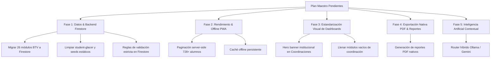

# Plan Maestro Consolidado: Tareas Pendientes

> **Proyecto:** Campus Salesiano San José  
> **Fecha:** 13 de octubre de 2026  
> **Estado:** Activo / En ejecución  
> **Contexto:** Consolidación de todos los planes anteriores (archivados en `planes/`) depurando lo ya implementado y priorizando el trabajo pendiente.

---

## 1. Diagnóstico y Visión General

El sistema cuenta con un núcleo funcional completo (autenticación Office 365 con cola de aprobación, asistencia/disciplina con sync Firestore, CRUD de infraestructura y gestión de proyectos escolares).

Este plan consolida las tareas técnicas pendientes categorizadas por criticidad:

---

## 2. Desglose de Fases y Tareas Pendientes

### FASE 1: Datos y Desacoplamiento de Memoria (Prioridad Alta 🔴)
*Objetivo: Cero datos curriculares o de prueba quemados en código estático; todo editable desde Firestore.*

- [ ] **1.1 Seeder oficial de Módulos BTV a Firestore:**
  - Crear script (`scripts/seed-btv-modules.cjs`) para cargar los 26 módulos técnicos y descriptores de `src/services/btvCurriculumData.ts` hacia la colección `lms_modules`.
  - Asegurar la asociación correcta de grados (`10t`, `11t`, `12t`) y secciones.
- [ ] **1.2 Desacoplar `lmsService.ts` de datos estáticos:**
  - Eliminar los objetos en memoria y las entregas fijas con ID `student-glacer` y `Estudiante Salesiano` en `src/services/lmsService.ts`.
  - Redirigir todas las lecturas de módulos para que consulten exclusivamente Firestore con manejo de estados vacíos (empty states) sin inyectar datos de prueba.
- [ ] **1.3 Reforzar validaciones en `firestore.rules`:**
  - Agregar reglas de formato y validación de tipos en escrituras de colecciones clave (`lms_modules`, `attendance_reports`, `students`).
  - Restringir la elevación del campo `role` para evitar modificaciones no autorizadas.

---

### FASE 2: Rendimiento, Paginación y Resiliencia (Prioridad Alta 🔴)
*Objetivo: Escalar el sistema para operar con más de 700 alumnos sin sobrecargar lectura ni fallar ante pérdidas de red.*

- [ ] **2.1 Paginación del lado del servidor para Alumnos:**
  - Modificar `getAllStudents()` en `src/lib/firestore.ts` para soportar cursores (`limit()`, `startAfter()`) y filtros por grado/sección a nivel de query.
  - Actualizar `StudentsManager.tsx` para consumir datos paginados con control de página siguiente/anterior o scroll infinito.
- [ ] **2.2 Resiliencia de Red y Soporte Offline (Patio/Canchas):**
  - Habilitar persistencia local en Firestore SDK (`enableIndexedDbPersistence` o `persistentMultipleTabManager`).
  - Configurar Service Worker básico / PWA para que la toma de asistencia en formación matutina no falle si se pierde la conexión Wi-Fi/móvil.
  - Indicador visual en cabecera: estado de conexión (🟢 En línea / 🟡 Offline - guardado local).

---

### FASE 3: Estandarización Estética de Dashboards (Prioridad Media 🟡)
*Objetivo: Llevar todas las pantallas al estándar visual de `InstitutionalCalendar.tsx`.*

- [ ] **3.1 Header institucional unificado en Coordinaciones:**
  - Reemplazar el contenedor plano de `src/components/coordinacion/` (`AcademicaDashboard`, `ConvivenciaDashboard`, `PrimariaDashboard`, `ParvulariaDashboard`) con el componente de Hero Banner oscuro con métricas KPI y badges con borde luminoso.
- [ ] **3.2 Implementación funcional de vistas secundarias:**
  - Reemplazar placeholders en `NotasView.tsx`, `HorarioView.tsx` y `ClaseView.tsx` con datos reales conectados a colecciones de Firestore.
  - Estandarizar formularios administrativos pendientes con la clase unificada `.card-crema` e `.input-crema`.

---

### FASE 4: Exportación Nativa de Documentos y PDF (Prioridad Media 🟡)
*Objetivo: Generar documentación institucional imprimible con formato oficial.*

- [ ] **4.1 Exportación a PDF nativo:**
  - Integrar motor de generación PDF (`jspdf` / `@react-pdf/renderer` o similar) para reportes de asistencia diaria y mensual de formación.
  - Exportación de boletas de notas y reportes consolidados por grado/sección.
- [ ] **4.2 Historial de versiones en Documentos Docente:**
  - Permitir guardar histórico o versiones previas de Guiones de Clase y Planificación Didáctica en Firestore (`lms_modules/{id}/docente_docs/versions`).

---

### FASE 5: Inteligencia Artificial Contextual (Prioridad Baja 🟢)
*Objetivo: Habilitar el router híbrido de IA para asistencia pedagógica.*

- [ ] **5.1 Router Híbrido (Ollama Local / Gemini Cloud):**
  - Implementar `src/ai/router.ts` con selección automática según complejidad y fallback automático si Ollama local está inaccesible.
- [ ] **5.2 Asistente Pedagógico Contextual:**
  - Integrar botón de sugerencias IA para redacción de actividades en la planificación docente y análisis predictivo de inasistencias en el panel de convivencia.

---

## 3. Matriz de Ejecución Inmediata

| # | Tarea | Componente / Archivo | Esfuerzo Estimado |
|---|---|---|---|
| **1** | Seeder de 26 módulos BTV a Firestore | `scripts/seed-btv-modules.cjs` | 2 - 3 horas |
| **2** | Limpieza de `student-glacer` y fallback en memoria | `src/services/lmsService.ts` | 1 - 2 horas |
| **3** | Paginación server-side de alumnos (728+) | `src/lib/firestore.ts`, `StudentsManager.tsx` | 3 - 4 horas |
| **4** | Hero Banner y métricas en Dashboards de Coordinación | `src/components/coordinacion/` | 2 - 3 horas |
| **5** | Exportación PDF de reportes de formación | `src/components/docente/SummaryModal.tsx` | 2 - 3 horas |
